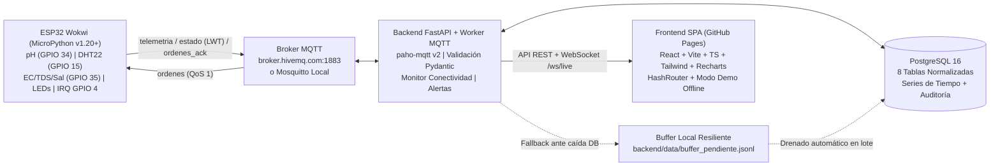

# AquaWeb IoT — Plataforma Web de Monitoreo, Control Remoto y Analítica Acuícola

Plataforma Full-Stack IoT orientada al cultivo de camarón (*Litopenaeus vannamei*) en Panamá. Diseñada bajo un enfoque **100% determinístico**: telemetría en tiempo real, reglas de alerta con histéresis, control remoto con acuse de recibo (`ack`) y analítica descriptiva/estadística (**sin modelos de IA ni Machine Learning**).

---

## 1. Arquitectura General del Monorepo



### Estructura de Carpetas
```text
aquaweb-plataforma/
├── wokwi/                               # Capa Embebida ESP32 MicroPython v1.20+
│   ├── diagram.json                     # Circuito ESP32 (pH, DHT22, EC/TDS/Sal, 2 LEDs, IRQ)
│   ├── umqtt_simple.py                  # Cliente MQTT 3.1.1 autónomo (LWT, QoS 1, check_msg)
│   └── main.py                          # Firmware no bloqueante con backoff 2..60s y ACK
├── database/                            # Capa de Base de Datos PostgreSQL 16
│   ├── init.sql                         # DDL idempotente (8 tablas, CHECKs, índices)
│   ├── seed.sql                         # Semilla realista de los últimos 7 días
│   └── mosquitto.conf                   # Broker Mosquitto opcional para pruebas locales
├── docs/
│   └── modelo_er.mmd                    # Diagrama Entidad-Relación en Mermaid
├── backend/                             # Capa Backend Python 3.11+ FastAPI
│   ├── config.py                        # Pydantic Settings (.env) y límites físicos
│   ├── database.py                      # Engine y sesiones SQLAlchemy 2.0 + psycopg
│   ├── models.py                        # Modelos ORM de las 8 tablas
│   ├── schemas.py                       # Validación estricta Pydantic v2
│   ├── main.py                          # API REST + WebSocket /ws/live + X-API-Key
│   ├── services/
│   │   ├── buffer.py                    # Respaldo local JSONL ante caídas de PostgreSQL
│   │   ├── telemetry_processor.py       # Calidad de dato, sensor congelado, saltos y alertas
│   │   ├── connectivity_monitor.py      # Transiciones ONLINE/SIN_DATOS/OFFLINE y timeouts
│   │   ├── analytics.py                 # Estadística descriptiva, índice de salud e histogramas
│   │   ├── mqtt_worker.py               # Worker paho-mqtt v2 con reconexión automática
│   │   └── ws_manager.py                # Difusión en tiempo real por WebSocket
│   └── tests/
│       └── test_aquaweb.py              # Suite automatizada pytest
├── frontend/                            # SPA React + Vite + TypeScript + Tailwind + Recharts
│   └── src/
│       ├── pages/                       # Overview, Histórico, Analítica, Alertas, Control, Reporte
│       ├── components/                  # GaugeCard, ServerConfigModal
│       └── lib/                         # API Client, Demo Offline, Exportación CSV/JSON
├── .github/workflows/deploy-pages.yml   # Despliegue automático a GitHub Pages
├── docker-compose.yml                   # PostgreSQL 16 + Mosquitto opcional
├── .env.example                         # Variables de entorno documentadas
└── requirements.txt                     # Dependencias Python
```

---

## 2. Modelo de Base de Datos (PostgreSQL 16)

El diagrama completo se encuentra en [`docs/modelo_er.mmd`](docs/modelo_er.mmd) y el DDL idempotente en [`database/init.sql`](database/init.sql). Todas las fechas utilizan `TIMESTAMPTZ` y las tablas aplican restricciones `CHECK` y claves foráneas:

1. **`estanques`**: metadatos del estanque (especie, volumen m³, ubicación).
2. **`dispositivos`**: nodos ESP32 (`client_id_mqtt` único, `estado_conexion`, `modo_operacion`, `actuador_activo`, `ultimo_latido`).
3. **`umbrales_parametros`**: rangos óptimos y físicos por parámetro (`ph`, `temperatura`, `tds`, `ec`, `salinidad`).
   - **pH:** óptimo `6.5 – 9.5` | físico `0.0 – 14.0`
   - **Temperatura:** óptimo `20.0 – 30.0 °C` | físico `-5.0 – 60.0 °C`
   - **TDS:** óptimo `4000 – 15000 ppm` | físico `0 – 50000 ppm`
   - **EC:** óptimo `10000 – 35000 ppm` | físico `0 – 80000 ppm`
   - **Salinidad:** óptimo `5000 – 23000 ppm` | físico `0 – 50000 ppm`
4. **`lecturas_telemetria`**: series de tiempo (`BIGSERIAL`) con índice compuesto `(dispositivo_id, recibido_en DESC)` y columna `calidad_dato` (`VALIDA` | `SOSPECHOSA`).
5. **`alertas`**: alertas determinísticas y de diagnóstico de sensor con histéresis/auto-resolución.
6. **`eventos_comunicacion`**: registro exclusivo de transiciones entre `ONLINE`, `SIN_DATOS` y `OFFLINE`.
7. **`ordenes_control`**: trazabilidad de órdenes MQTT por `command_id` (`UUID`) y estados `ENVIADA` / `APLICADA` / `RECHAZADA` / `EXPIRADA`.
8. **`mensajes_rechazados`**: auditoría forense de tramas JSON corruptas o físicamente imposibles.

---

## 3. Ejecución Local Paso a Paso

### Paso 1: Configurar entorno y levantar PostgreSQL 16
```bash
cp .env.example .env
docker compose up -d postgres
# Opcional: incluir broker Eclipse Mosquitto local
docker compose --profile local-mqtt up -d
```
> Al iniciar por primera vez, PostgreSQL ejecuta automáticamente `database/init.sql` y `database/seed.sql` (7 días de datos realistas). Para usar PostgreSQL administrado en la nube (Neon, Supabase, RDS), basta cambiar `DATABASE_URL` en `.env`.

### Paso 2: Iniciar el Backend FastAPI + Worker MQTT
```bash
pip install -r requirements.txt
uvicorn backend.main:app --host 0.0.0.0 --port 8000 --reload
```
- Documentación interactiva Swagger: `http://localhost:8000/docs`
- WebSocket en tiempo real: `ws://localhost:8000/ws/live`

### Paso 3: Conectar el ESP32 en Wokwi
1. Abrir Wokwi y crear un proyecto **MicroPython on ESP32**.
2. Cargar `wokwi/diagram.json`, `wokwi/umqtt_simple.py` y `wokwi/main.py`.
3. Verificar en `wokwi/main.py` que `MQTT_BROKER = "broker.hivemq.com"`, `GRUPO = "grupo"` y `DEVICE_ID = "estanque-01"` coincidan con `.env`.
4. Presionar **Start Simulation**. Ajustar los potenciómetros de pH (GPIO 34) y EC/TDS/Salinidad (GPIO 35), el DHT22 (GPIO 15) o el botón físico de bypass (GPIO 4).

### Paso 4: Ejecutar el Frontend en Local
```bash
cd frontend
npm install
npm run dev
```
Abrir `http://localhost:5173`. Si el backend no está encendido, la aplicación activa automáticamente el **Modo Demo Offline** con datos realistas para explorar todas las vistas.

---

## 4. Pruebas Automatizadas

```bash
pytest backend/tests -v
```
Verifica validación estricta, auditoría de mensajes rechazados, detección de sensor congelado y saltos abruptos, alertas sin duplicados con auto-resolución, buffer JSONL ante caída de PostgreSQL, transiciones `ONLINE -> SIN_DATOS -> OFFLINE`, timeout de órdenes y seguridad `X-API-Key` (HTTP 401 / 422).

---

## 5. Despliegue del Frontend en GitHub Pages

1. Subir el monorepo a GitHub en la rama `main`.
2. En **Settings → Pages → Source**, seleccionar **GitHub Actions**.
3. (Opcional) En **Settings → Secrets and variables → Actions → Variables**, definir `VITE_API_URL` con la URL HTTPS pública del backend FastAPI.
4. Al hacer push a `main`, el workflow [`.github/workflows/deploy-pages.yml`](.github/workflows/deploy-pages.yml) compila y publica la SPA usando `HashRouter` y `VITE_BASE_PATH` automático.
5. Desde la web publicada, el botón **Servidor** permite cambiar la URL del backend o la `X-API-Key` (guardados en `localStorage`) o activar/desactivar el **Modo Demo Offline** en cualquier momento.
