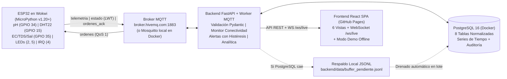

# Guía Maestra de Presentación y Operación — AquaWeb IoT

**Proyecto:** AquaWeb IoT — Plataforma de Monitoreo, Control Remoto y Analítica Descriptiva Acuícola  
**Asignatura:** Desarrollo de Software VIII (Universidad Tecnológica de Panamá)  
**Docente:** Prof. José Collado  
**Estudiante:** Cristian Joel Pinto Ortega — Cédula: `8-1015-1885`  
**Repositorio GitHub:** https://github.com/Cris19111/AquaWeb  
**Dashboard Web (GitHub Pages):** https://cris19111.github.io/AquaWeb/

---

## 1. Resumen Ejecutivo y Visión General

**AquaWeb IoT** es una plataforma IoT Full-Stack diseñada para el monitoreo continuo, control remoto de actuadores (bomba/aireador) y análisis estadístico descriptivo de la calidad del agua en estanques de cultivo de camarón (*Litopenaeus vannamei*) en Panamá.

- **Principio clave de diseño (Restricción de alcance):** El sistema es **100% determinístico**. Utiliza telemetría en tiempo real, reglas explícitas basadas en umbrales físicos/óptimos, detección determinística de fallos de sensores y estadística descriptiva (**no utiliza entrenamiento ni modelos de Inteligencia Artificial o Machine Learning**).

### ¿Cómo está organizado el repositorio?
El repositorio contiene **dos entregables complementarios y desacoplados**:

1. **Raíz del repositorio (`/` — Entregable Avance 3: Módulo MQTT):**
   - `wokwi/`: ESP32 MicroPython con 2 sensores (pH y Temperatura), LEDs, botón IRQ y comunicación MQTT (`telemetria`, `estado` con LWT, `ordenes`).
   - `backend/`: Scripts independientes (`receptor_mqtt.py`, `monitor_estado.py`, `simulador_pruebas.py`) con persistencia en archivos CSV (`telemetria_valida.csv`, `eventos_comunicacion.csv`).
   - `docs/`: Informe técnico académico (`Informe_Avance3_AquaWeb_IoT.docx` / `.pdf` de 5 páginas), diagrama PlantUML y capturas reales.
2. **Plataforma Full-Stack (`aquaweb-plataforma/`):**
   - `wokwi/`: ESP32 MicroPython ampliado a **5 variables acuícolas** (pH, Temperatura, TDS, EC, Salinidad) + canal de acuse de recibo `ordenes_ack`.
   - `database/`: Esquema normalizado de **8 tablas en PostgreSQL 16** (`init.sql`) y datos semilla de los últimos 7 días (`seed.sql`).
   - `backend/`: API REST + WebSocket (`/ws/live`) en **FastAPI**, Worker MQTT `paho-mqtt >= 2.1.0`, analítica descriptiva y buffer local resiliente ante caídas de base de datos.
   - `frontend/`: Aplicación web SPA en **React + Vite + TypeScript + Tailwind CSS + Recharts** preparada para **GitHub Pages** con **Modo Demo Offline**.

### Diagrama de Arquitectura Completa



---

## 2. Capa 1 — Simulación Embebida en Wokwi (ESP32 + MicroPython v1.20+)

### 2.1 Hardware y Pines GPIO
Ambas versiones del circuito utilizan la placa `board-esp32-devkit-c-v4` conectada a `Wokwi-GUEST`:

| Componente | Pin ESP32 | Configuración MicroPython | Función |
| :--- | :--- | :--- | :--- |
| Potenciómetro pH | **GPIO 34** | `ADC`, `ADC.ATTN_11DB`, `ADC.WIDTH_12BIT` | Escala `0–4095` a `0.00–14.00 pH` |
| Sensor `wokwi-dht22` | **GPIO 15** | Bus 1-Wire (`dht.DHT22`) | Lee temperatura (`°C`) con `try/except OSError` |
| Potenciómetro EC *(Full-Stack)* | **GPIO 35** | `ADC`, `ADC.ATTN_11DB`, `ADC.WIDTH_12BIT` | Mide **EC** (`0–45000 ppm`) y deriva **TDS** (`~0.48×EC`) y **Salinidad** (`~0.65×EC`) |
| LED Rojo + `220 Ω` | **GPIO 2** | `Pin.OUT` | Actuador (bomba/aireador): encendido si sale de rango óptimo o en `MANUAL` |
| LED Azul + `220 Ω` | **GPIO 5** | `Pin.OUT` | Conectividad: fijo = conectado; parpadeo/apagado = desconectado |
| Pushbutton Verde | **GPIO 4** | `Pin.IN`, `Pin.PULL_DOWN`, `Pin.IRQ_RISING` | Interrupción física de bypass manual con antirrebote (`250 ms`) |

> **Punto clave para mencionar en la presentación:** En MicroPython v1.20+ es obligatorio usar `ADC.ATTN_11DB` (nunca `ATTN_11V`, que no existe o falla en versiones modernas) para poder leer el rango completo `0–3.3 V` sin saturación.

### 2.2 Lógica del Firmware (`wokwi/main.py`)
1. **Bucle no bloqueante (`time.ticks_ms()` / `time.ticks_diff()`):** No usa `time.sleep()` largos. Cada `50 ms` revisa el botón físico, recibe órdenes con `mqtt_client.check_msg()`, muestrea sensores cada `2 s` y publica telemetría cada `5 s`.
2. **Interrupción física (GPIO 4):** La ISR solo activa la bandera `irq_cambio_pendiente = True` si pasaron más de `250 ms` desde la última pulsación (debounce). El cambio real (`AUTO ↔ MANUAL`) se procesa fuera de la ISR para mantener estabilidad.
3. **Resiliencia Offline y Backoff Exponencial:** Si se pierde el Wi-Fi o el broker MQTT, el nodo **no deja de proteger el estanque**: sigue leyendo sensores y encendiendo/apagando el actuador en local mientras reintenta reconectarse duplicando la espera (`2 → 4 → 8 → 16 → 32 → 60 s`).
4. **Modo silencio controlado (`simular_silencio`):** Deja de publicar en `.../telemetria`, pero envía `mqtt_client.ping()` (`PINGREQ`) cada `7 s` para que el broker mantenga viva la sesión (`keepalive = 15 s`) y el monitor detecte `SIN_DATOS` sin disparar `OFFLINE`.

### 2.3 Protocolo MQTT y Bug Crítico Resuelto en `umqtt_simple.py`
Esquema de temas (Avance 3 usa `utp/ds8/grupo/aquaweb/...`; Full-Stack añade `estanque-01/`):

| Tema MQTT | Dirección | QoS (Verificado) | Retenido | Propósito |
| :--- | :--- | :---: | :---: | :--- |
| `.../telemetria` | ESP32 → Broker | `0` (Avance 3) / `1` (Full-Stack) | No | Envía lecturas JSON, estado del actuador y modo |
| `.../estado` | ESP32 → Broker | `1` | **Sí** | `"ONLINE"` al conectar; `"OFFLINE"` automático vía **LWT** del broker al desconectarse sin `DISCONNECT` |
| `.../ordenes` | Broker → ESP32 | `1` (emisor) / `0–1` (ESP32) | No | Cambia `modo`, `actuador`, `umbrales` o `simular_silencio` |
| `.../ordenes_ack` *(Full-Stack)* | ESP32 → Broker | `1` | No | Confirma `APLICADA` o `RECHAZADA` con el `command_id` (UUID) |

**Hallazgo técnico real para lucirse en la defensa:**
Al probar el ESP32 en Wokwi, el socket fallaba con `[Errno 116] ETIMEDOUT`. Al inspeccionar `umqtt_simple.py` byte a byte, se descubrió que la cabecera variable del paquete MQTT 3.1.1 `CONNECT` tenía **9 bytes** (`b"\x04MQTT\x04\x02\0\0"`) en vez de **10 bytes** (faltaba el `\x00` MSB del largo de `"MQTT"`), desplazando los flags y el `keepalive`. Al corregirlo a `b"\x00\x04MQTT\x04\x02\0\0"` e indexar `msg[7]`, `msg[8]` y `msg[9]`, `broker.hivemq.com` respondió `CONNACK rc=0` al instante.

### 2.4 Cómo correr la simulación en Wokwi paso a paso
1. Ir a **https://wokwi.com/projects/new/micropython-esp32**.
2. Pegar `diagram.json` y `main.py` (de `wokwi/` para el Avance 3, o de `aquaweb-plataforma/wokwi/` para la plataforma de 5 variables).
3. En la flecha `▼` junto a las pestañas de archivos → **New file...** → crear **`umqtt_simple.py`** y pegar el archivo corregido.
4. Presionar **Start Simulation** (botón verde).
   - Verás `[WIFI OK] IP asignada: 10.10.0.2`, `[MQTT OK] Conectado. Publicado ONLINE` y cada 5 s `[TELEMETRIA TX]`.
   - Mueve los potenciómetros o el DHT22 para ver cambiar los valores y encenderse el LED rojo.
   - Presiona **Stop Simulation** para comprobar que tras ~`15–22 s` el broker dispara automáticamente el Testamento **LWT `OFFLINE`**.

---

## 3. Capa 2 — Base de Datos PostgreSQL 16 y Docker

### 3.1 Modelo Entidad-Relación (8 Tablas Normalizadas)
Definido en `aquaweb-plataforma/docs/modelo_er.mmd` e implementado de forma idempotente en `aquaweb-plataforma/database/init.sql` (con `TIMESTAMPTZ`, llaves foráneas `ON DELETE CASCADE` y restricciones `CHECK`):

1. **`estanques`**: datos del estanque (*Estanque Camaronero #1 - Aguadulce*, `4500.00 m³`, *Litopenaeus vannamei*).
2. **`dispositivos`**: nodos ESP32 (`client_id_mqtt = 'estanque-01'`, `estado_conexion`, `modo_operacion`, `actuador_activo`, `ultimo_latido`).
3. **`umbrales_parametros`**: rangos óptimos y físicos por parámetro:
   - **pH:** óptimo `6.5 – 9.5` | físico `0.0 – 14.0`
   - **Temperatura:** óptimo `20.0 – 30.0 °C` | físico `-5.0 – 60.0 °C`
   - **TDS:** óptimo `4000 – 15000 ppm` | físico `0 – 50000 ppm`
   - **EC:** óptimo `10000 – 35000 ppm` | físico `0 – 80000 ppm`
   - **Salinidad:** óptimo `5000 – 23000 ppm` | físico `0 – 50000 ppm`
4. **`lecturas_telemetria`**: serie de tiempo (`BIGSERIAL`) con `calidad_dato` (`VALIDA` | `SOSPECHOSA`) e índice compuesto obligatorio `(dispositivo_id, recibido_en DESC)`.
5. **`alertas`**: alertas activas, reconocidas o resueltas (`ADVERTENCIA` | `CRITICA`).
6. **`eventos_comunicacion`**: auditoría de transiciones `ONLINE`, `SIN_DATOS`, `OFFLINE`.
7. **`ordenes_control`**: historial de órdenes por `command_id` (`UUID`) y payload `JSONB` (`ENVIADA`, `APLICADA`, `RECHAZADA`, `EXPIRADA`).
8. **`mensajes_rechazados`**: auditoría forense de paquetes corruptos o físicamente imposibles.

### 3.2 Cómo levantar y verificar la Base de Datos en Docker
Primero abre **Docker Desktop** en Windows y luego ejecuta dentro de `aquaweb-plataforma/`:

```powershell
# Opción A: Levantar SOLO PostgreSQL 16 (para correr FastAPI en tu terminal)
docker compose up -d postgres

# Opción B: Levantar PostgreSQL 16 + Mosquitto local + Backend FastAPI en contenedores
docker compose --profile full up -d
```

**¿Qué ocurre en el primer arranque?**
PostgreSQL ejecuta automáticamente `01_init.sql` (crea las 8 tablas e índices) y `02_seed.sql` (inserta el estanque piloto, los 5 umbrales, **336 lecturas realistas de los últimos 7 días** usando `generate_series`, 4 alertas, 5 eventos de comunicación, 4 órdenes y 2 mensajes rechazados).

**Comandos útiles para mostrar la BD en vivo durante la presentación:**
```powershell
# Ver estado de los contenedores
docker ps --filter "name=aquaweb"

# Listar las 8 tablas y contar sus registros reales
docker exec aquaweb-postgres psql -U aquaweb -d aquaweb_iot -c "\dt"
docker exec aquaweb-postgres psql -U aquaweb -d aquaweb_iot -c "SELECT 'lecturas' AS tabla, COUNT(*) FROM lecturas_telemetria UNION ALL SELECT 'alertas', COUNT(*) FROM alertas UNION ALL SELECT 'eventos', COUNT(*) FROM eventos_comunicacion;"

# Detener contenedores sin borrar datos (el volumen aquaweb_pgdata conserva todo)
docker compose --profile full down
```

> **Compatibilidad con la nube:** Para migrar de Docker a PostgreSQL administrado (Neon, Supabase, AWS RDS), solo cambia `DATABASE_URL` en `.env`.

---

## 4. Capa 3 — Backend (Scripts Avance 3 + Plataforma FastAPI)

### 4.1 Modo 1: Scripts Independientes del Avance 3 (Carpeta raíz)
Ideales para demostrar el módulo puro de comunicación MQTT:
```powershell
# Terminal 1: Receptor de telemetría (guarda lecturas válidas en backend/data/telemetria_valida.csv)
python -u backend/receptor_mqtt.py

# Terminal 2: Monitor de conectividad (registra solo transiciones en backend/data/eventos_comunicacion.csv)
python -u backend/monitor_estado.py

# Terminal 3: Emisor de pruebas CLI hacia el ESP32 o receptor
python backend/simulador_pruebas.py --escenario orden-valida
python backend/simulador_pruebas.py --escenario orden-invalida
python backend/simulador_pruebas.py --escenario dato-invalido
python backend/simulador_pruebas.py --escenario silencio-on
python backend/simulador_pruebas.py --escenario silencio-off
```

### 4.2 Modo 2: Backend Full-Stack FastAPI (`aquaweb-plataforma/backend/`)
Construido en Python 3.11+ con **FastAPI**, **Uvicorn**, **SQLAlchemy 2.0 (`psycopg`)**, **Pydantic v2** y **`paho-mqtt >= 2.1.0`** (`CallbackAPIVersion.VERSION2`).

**Cómo iniciarlo en local (con PostgreSQL corriendo en Docker):**
```powershell
cd aquaweb-plataforma
uvicorn backend.main:app --host 0.0.0.0 --port 8000 --reload
```
*(Si usaste `docker compose --profile full up -d`, el backend ya corre automáticamente en `http://localhost:8000`).*

### 4.3 Defensas de Producción Implementadas (Puntos clave para explicar)
1. **Validación estricta + Auditoría Forense (`schemas.py`, `telemetry_processor.py`):**
   Rechaza JSON corruptos, payloads vacíos, tipos booleanos disfrazados de números, `NaN`/`Infinity` y valores fuera de rango físico (ej. `pH = 19` o `Temp = 200 °C`). El worker nunca se detiene y registra el payload crudo en `mensajes_rechazados`.
2. **Detección de Fallos de Sensor (`calidad_dato = 'SOSPECHOSA'`):**
   - *Sensor congelado:* detecta valores exactamente idénticos durante `N` ciclos consecutivos (`FROZEN_SENSOR_CYCLES = 5`).
   - *Saltos abruptos:* detecta variaciones físicamente improbables en pocos segundos (ej. cambio de pH > `2.5` en `<= 30 s`). Genera una alerta de mantenimiento.
3. **Resiliencia ante caída de PostgreSQL (`services/buffer.py`):**
   Si PostgreSQL deja de responder temporalmente, el worker guarda las lecturas válidas en `backend/data/buffer_pendiente.jsonl`. Apenas vuelve la conexión, las drena en lote automáticamente sin perder datos.
4. **Histéresis / Cooldown en Alertas:**
   No crea alertas duplicadas cada 5 segundos si un parámetro sigue fuera de rango; actualiza la alerta activa y la resuelve automáticamente (`RESUELTA`) solo tras ciclos consecutivos dentro del rango óptimo.
5. **Monitor de Conectividad y Timeout de Órdenes (`services/connectivity_monitor.py`):**
   Marca `SIN_DATOS` si no llegan lecturas en `>= 3 × intervalo_pub_seg` (`15 s`), `OFFLINE` al recibir el LWT, y marca como `EXPIRADA` cualquier orden sin respuesta en `.../ordenes_ack` tras `15 s`.
6. **Seguridad Web:**
   CORS configurado para `localhost` y `https://cris19111.github.io`, y protección con cabecera **`X-API-Key`** (`aquaweb-dev-key-2026` por defecto) en `POST /api/commands` y `PUT /api/thresholds` (rechaza con `401` si falta/es inválida y `422` si la orden es incoherente o el nodo está `OFFLINE`).

### 4.4 Endpoints Principales (Swagger en `http://localhost:8000/docs`)
- `GET /api/health` — Estado de BD, MQTT y buffer pendiente.
- `GET /api/overview` — Última lectura, sparkline, umbrales y estado del dispositivo.
- `GET /api/telemetry?range=7d&aggregation=hour` — Series históricas (`raw`, `minute`, `hour`).
- `GET /api/analytics?range=7d` — Estadística descriptiva, Índice de Salud %, uptime %, histogramas y violaciones por franja horaria.
- `GET /api/alerts` y `PATCH /api/alerts/{id}` — Gestión de alertas (`RECONOCIDA` / `RESUELTA`).
- `GET /api/connectivity/events` — Línea de tiempo y disponibilidad (%).
- `GET /api/data-quality` — Lecturas `SOSPECHOSA` y tabla `mensajes_rechazados`.
- `POST /api/commands` y `PUT /api/thresholds` — Control remoto y ajuste de umbrales (requieren `X-API-Key`).
- `WS /ws/live` — WebSocket que empuja telemetría, eventos y ACKs en tiempo real al dashboard.

### 4.5 Ejecutar Pruebas Automatizadas (`pytest`)
```powershell
cd aquaweb-plataforma
python -m pytest backend\tests -v
```
Las **5 suites de prueba** validan automáticamente: rechazo de telemetría corrupta, sensor congelado/salto abrupto + histéresis de alertas, buffer JSONL ante caída de BD y posterior drenado, máquina de estados `ONLINE → SIN_DATOS → OFFLINE` + expiración de órdenes, y seguridad `401`/`422` en FastAPI.

---

## 5. Capa 4 — Frontend Web (React + Vite + Tailwind + Recharts + GitHub Pages)

### 5.1 Las 6 Vistas del Dashboard
1. **Tiempo Real (`/`):** Barra superior con estado en vivo (`ONLINE` / `SIN_DATOS` / `OFFLINE`), modo (`AUTO` / `MANUAL`), bomba (`ON`/`OFF`), estado WebSocket, 5 medidores tipo *gauge* con código semafórico (Óptimo, Advertencia, Crítico), delta y mini-gráfica *sparkline*.
2. **Histórico (`/historico`):** Filtros (`1h`, `6h`, `24h`, `7d`, `30d` o rango personalizado), agregación (`Crudo`, `/min`, `/hora`), bandas verdes del rango óptimo y gráfica comparativa de **doble eje** (ej. Temperatura vs. pH).
3. **Analítica (`/analitica`):** Tabla descriptiva (promedio, mediana, mínimo, máximo, desviación estándar, tasa de variación, cumplimiento %), Índice de Salud del Estanque, violaciones por franja (mañana/tarde/noche) e histogramas de frecuencia.
4. **Alertas y Auditoría (`/alertas`):** Filtros de alertas con botones **Reconocer** y **Resolver**, línea de tiempo de conectividad con Uptime %, y pestaña de **Calidad de Datos / Mensajes Rechazados**.
5. **Control Remoto (`/control`):** Botones con modal de confirmación para cambiar `AUTO`/`MANUAL`, encender/apagar bomba, editar umbrales en PostgreSQL + MQTT y tabla en vivo del estado de órdenes (`ENVIADA`, `APLICADA`, `RECHAZADA`, `EXPIRADA`).
6. **Reporte PDF (`/reporte`):** Exportación directa a **CSV**, **JSON** y vista de **Reporte Técnico Imprimible** (`window.print()` estilizado para guardar como PDF).

### 5.2 Cómo funciona en Local y en GitHub Pages
- **Ejecutar en local:**
  ```powershell
  cd aquaweb-plataforma\frontend
  npm install
  npm run dev
  ```
  Abrir `http://localhost:5173`.
- **Compilar para producción:** `npm run build` (genera `dist/`).
- **Soporte real para GitHub Pages:**
  - Usa **`HashRouter`** (`/#/historico`, etc.) para que GitHub Pages nunca devuelva error 404 al recargar la página.
  - Workflow automático en `.github/workflows/deploy-pages.yml`.
  - **Botón "Servidor":** abre un modal que guarda en `localStorage` la URL HTTPS de tu backend (por si expones tu FastAPI con ngrok/Cloudflare Tunnel/Render) y la `X-API-Key`.
  - **Modo Demo Offline Integrado:** si GitHub Pages no detecta un backend activo (o activas el botón **Modo Demo**), la aplicación carga automáticamente 7 días de datos simulados realistas y permite probar todas las gráficas, analítica, alertas, control y exportaciones sin fallar.

---

## 6. Guión Sugerido para tu Presentación (10–12 Minutos)

| Tiempo | Lámina / Bloque | Qué explicar y mostrar |
| :---: | :--- | :--- |
| **1 min** | **1. Problema y Alcance** | Monitoreo de camarón en Panamá (pH, Temp, TDS, EC, Salinidad). Recalcar enfoque **determinístico sin IA/ML**. |
| **2 min** | **2. Arquitectura General** | Mostrar el diagrama Mermaid: ESP32 Wokwi ↔ Broker MQTT ↔ Backend FastAPI/Python ↔ PostgreSQL 16 ↔ React GitHub Pages. |
| **2.5 min** | **3. Nodo Embebido (Wokwi)** | Pines GPIO, `ADC.ATTN_11DB`, IRQ GPIO 4, bucle no bloqueante, backoff `2→60 s`, LWT retenido y la anécdota técnica de la corrección de 10 bytes en `umqtt_simple.py`. |
| **2 min** | **4. Base de Datos y Defensas** | Mostrar las 8 tablas en `modelo_er.mmd`, índice compuesto, auditoría `mensajes_rechazados`, sensor congelado, histéresis de alertas y `buffer_pendiente.jsonl`. |
| **3 min** | **5. Demostración en Vivo** | Correr Wokwi + Backend + Dashboard web (ver secuencia paso a paso abajo). |
| **1 min** | **6. Pruebas y Cierre** | Mostrar `pytest` (5/5 aprobadas), pruebas de GitHub Pages y conclusiones. |

### Checklist Rápido para la Demo en Vivo (Sin Sorpresas)
1. **Antes de empezar a hablar:**
   - Abre Docker Desktop y ejecuta `cd aquaweb-plataforma; docker compose up -d postgres`.
   - Inicia el backend en Terminal 1: `uvicorn backend.main:app --host 0.0.0.0 --port 8000`.
   - Inicia el frontend en Terminal 2: `cd aquaweb-plataforma\frontend; npm run dev` (o ten abierta la URL de GitHub Pages).
   - Ten lista la pestaña de **Wokwi** con `aquaweb-plataforma/wokwi/` cargado y presiona **Start Simulation**.
2. **Durante la demo (2 minutos):**
   - Muestra la telemetría entrando en tiempo real al dashboard (`/`) y varía el potenciómetro en Wokwi.
   - Ve a **Control Remoto**, cambia a `MANUAL` y enciende la bomba → señala en vivo cómo se enciende el **LED rojo (GPIO 2)** en Wokwi y el estado de la orden pasa de `ENVIADA` a `APLICADA`.
   - Muestra **Analítica Descriptiva** (Índice de Salud, tabla estadística, histogramas) y **Alertas/Calidad de Datos**.
   - Presiona **Stop Simulation** en Wokwi y comenta que tras `15–22 s` el broker disparará el LWT `OFFLINE`.
3. **Plan B (si falla Internet o el Wi-Fi del aula):**
   - Activa el botón **Modo Demo** en la barra superior del frontend (o abre `https://cris19111.github.io/AquaWeb/`) y explica que el dashboard opera de forma autónoma para pruebas de interfaz y reportes, mientras muestras en local las pruebas `pytest` y las consultas a PostgreSQL en Docker.

---

## 7. Respuestas Cortas a Preguntas Frecuentes del Profesor

1. **¿Por qué no usaron Inteligencia Artificial?**  
   Porque la especificación y el dominio crítico acuícola requieren trazabilidad determinística y explicable: umbrales biológicos conocidos para *Litopenaeus vannamei*, reglas exactas de histéresis y estadística descriptiva verificable sin cajas negras.
2. **¿Qué pasa si se cae la conexión Wi-Fi o el broker MQTT?**  
   El ESP32 sigue muestreando cada `2 s`, controlando la bomba localmente en modo `AUTO` y atendiendo la interrupción física de emergencia (`GPIO 4`) sin bloquearse, mientras reintenta conectarse con backoff exponencial (`2, 4, 8, 16, 32, 60 s`).
3. **¿Cómo garantizan que no se pierdan datos si falla la base de datos PostgreSQL?**  
   El worker captura `SQLAlchemyError`, guarda las lecturas válidas en `backend/data/buffer_pendiente.jsonl` y las drena automáticamente en lote cuando PostgreSQL vuelve a responder.
4. **¿Cómo diferencian un dispositivo apagado (`OFFLINE`) de uno que está conectado pero dejó de enviar datos (`SIN_DATOS`)?**  
   Si el ESP32 mantiene la sesión MQTT con `PINGREQ` pero no publica telemetría durante `>= 3 × intervalo_pub_seg`, el monitor marca `SIN_DATOS`. Si se desconecta abruptamente sin enviar `DISCONNECT`, el broker espera el `keepalive` (`15 s`) y publica automáticamente el **Last Will (`OFFLINE`)** retenido en `.../estado`.
5. **¿Cómo evitan que una alarma genere cientos de registros duplicados en la BD?**  
   Se aplica actualización *upsert* sobre la alerta `ACTIVA`/`RECONOCIDA` existente para ese dispositivo y parámetro, y solo se marca `RESUELTA` tras `N` lecturas consecutivas dentro del rango óptimo (histéresis).
6. **¿Por qué GitHub Pages usa `HashRouter` y qué seguridad tienen los comandos?**  
   GitHub Pages solo sirve archivos estáticos y daría `404` con rutas HTML5 al recargar (`/#/` lo evita). Los endpoints críticos de control y umbrales exigen cabecera `X-API-Key`, validan rangos con Pydantic v2 y rechazan órdenes si el nodo está `OFFLINE`.
