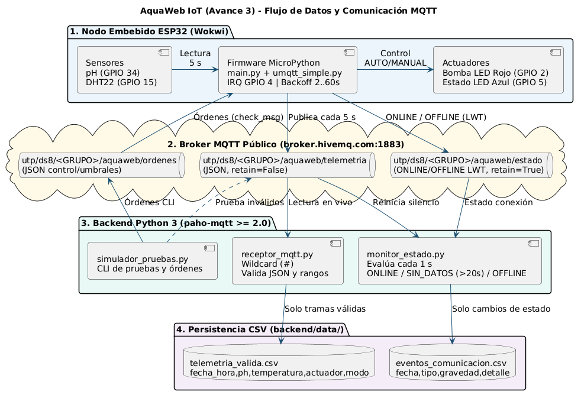
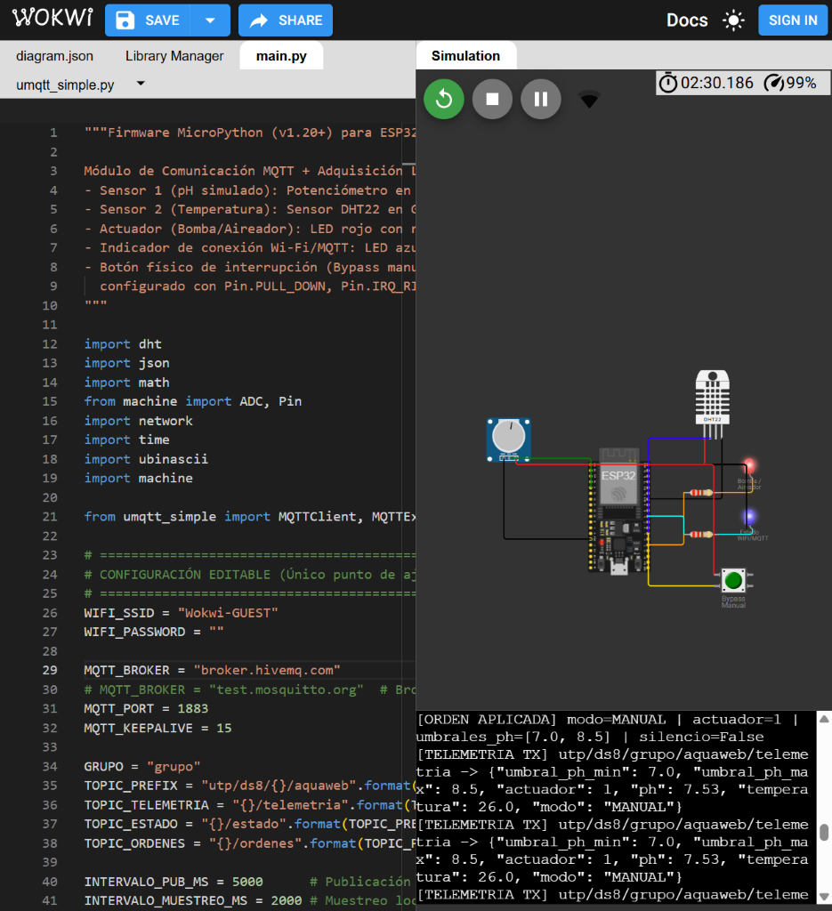
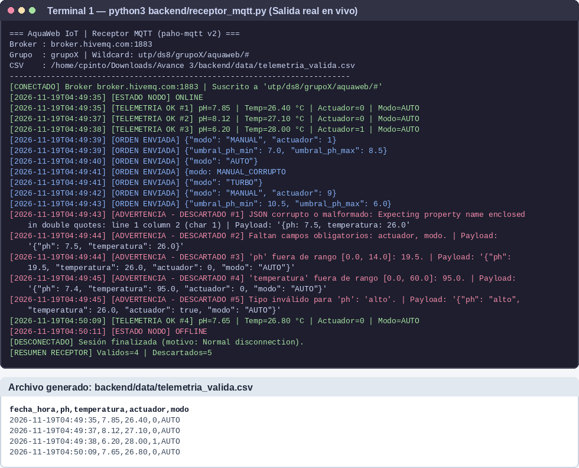
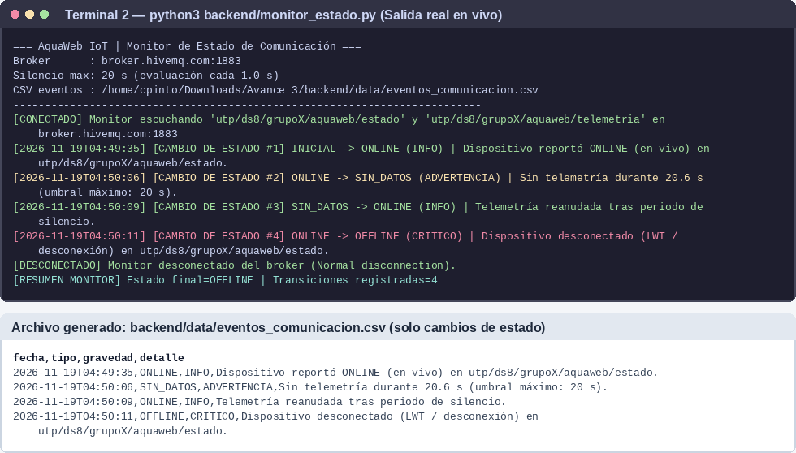

# AquaWeb IoT – Avance 3: Módulo de Comunicación MQTT

---

## 1. Hoja de Presentación

- **Universidad:** Universidad Tecnológica de Panamá (UTP)
- **Facultad:** Facultad de Ingeniería de Sistemas Computacionales
- **Asignatura:** Desarrollo de Software VIII
- **Docente:** Prof. José Collado
- **Proyecto:** AquaWeb IoT – Avance 3: Módulo de Comunicación MQTT
- **Estudiante:** Cristian Joel Pinto Ortega — Cédula: `8-1015-1885`
- **Grupo:** `grupo` (DS8)
- **Fecha:** 25 de noviembre de 2026
- **Repositorio GitHub:** https://github.com/Cris19111/AquaWeb
- **Dashboard Web (GitHub Pages):** https://cris19111.github.io/AquaWeb/
- **Simulación en Wokwi:** Proyecto ESP32 MicroPython definido en `wokwi/diagram.json`, `wokwi/main.py` y `wokwi/umqtt_simple.py`

---

## 2. Descripción del Módulo de Comunicación

El módulo de comunicación de **AquaWeb IoT** conecta el nodo embebido simulado en Wokwi (**ESP32 + MicroPython v1.20+**) con el backend de supervisión en **Python 3** mediante el protocolo **MQTT** sobre el broker público `broker.hivemq.com:1883`. El sistema opera de forma determinística (sin IA/ML) para monitorear pH y temperatura en estanques camaroneros de Panamá.

1. **Nodo Wokwi (`wokwi/main.py`, `wokwi/umqtt_simple.py`):** Adquiere pH (GPIO 34 con `ADC.ATTN_11DB`) y temperatura DHT22 (GPIO 15), controla la bomba/aireador (LED rojo en GPIO 2), indica conectividad (LED azul en GPIO 5) y atiende un botón físico de bypass manual (GPIO 4 con `Pin.IRQ_RISING` y antirrebote de `250 ms`). Publica telemetría JSON cada `5 s`, gestiona órdenes remotas con `check_msg()`, ejecuta `ping()` explícito en modo silencio, registra testamento **LWT** (`OFFLINE`, QoS 1, retenido) antes de conectar y tolera caídas de red con backoff exponencial (`2` a `60 s`) conservando el control automático local offline.
2. **Broker MQTT (`broker.hivemq.com:1883`):** Desacopla al nodo y al backend enrutando los temas bajo `utp/ds8/grupo/aquaweb/#` y reteniendo el estado de conectividad.
3. **Programa Receptor (`backend/receptor_mqtt.py`):** Implementado con `paho-mqtt >= 2.1.0` (`CallbackAPIVersion.VERSION2`), se suscribe con comodín `#` (QoS 0), valida sintaxis JSON, tipos estrictos y rangos físicos, descarta tramas corruptas sin detenerse y guarda lecturas válidas en `backend/data/telemetria_valida.csv`.
4. **Monitor de Estado (`backend/monitor_estado.py`):** Script independiente con `loop_start()` y evaluación no bloqueante cada `1 s`. Distingue `ONLINE`, `SIN_DATOS` (`SILENCIO_MAX_SEG = 20 s`) y `OFFLINE`, persistiendo en `backend/data/eventos_comunicacion.csv` únicamente las transiciones de estado.

---

## 3. Esquema de Temas MQTT y Ejemplos de Mensajes JSON

La siguiente tabla refleja exactamente los niveles de **QoS** y bandera **Retenido** verificados en `wokwi/main.py`, `wokwi/umqtt_simple.py`, `backend/receptor_mqtt.py`, `backend/monitor_estado.py` y `backend/simulador_pruebas.py`:

| Tema MQTT | Dirección | QoS | Retenido | Contenido / Formato |
| :--- | :--- | :--- | :--- | :--- |
| `utp/ds8/grupo/aquaweb/telemetria` | Dispositivo → Broker | `0` (pub ESP32 y sub backend) | No (`False`) | JSON con `ph`, `temperatura`, `actuador`, `modo`, `umbral_ph_min`, `umbral_ph_max` |
| `utp/ds8/grupo/aquaweb/estado` | Dispositivo → Broker | `1` (pub `ONLINE`, LWT `OFFLINE` y sub monitor) | Sí (`True`) | Cadena `"ONLINE"` al conectar o `"OFFLINE"` emitido por el broker vía Last Will (LWT) |
| `utp/ds8/grupo/aquaweb/ordenes` | Broker → Dispositivo | `1` (pub emisor CLI) / `0` (sub ESP32) | No (`False`) | JSON con comandos de `modo`, `actuador`, `umbral_ph_min`, `umbral_ph_max` o `simular_silencio` |

**Ejemplo de telemetría (`.../telemetria`, QoS 0):**
```json
{"ph": 7.85, "temperatura": 26.4, "actuador": 0, "modo": "AUTO", "umbral_ph_min": 6.5, "umbral_ph_max": 9.5}
```

**Ejemplo de orden válida (`.../ordenes`):**
```json
{"modo": "MANUAL", "actuador": 1}
```

**Ejemplo de estado (`.../estado`, QoS 1, retenido):**
```text
"ONLINE"   (al conectar)  |  "OFFLINE"  (disparado por el broker vía LWT tras vencer keepalive=15s)
```

---

## 4. Diagrama de Flujo de Datos

El flujo inicia en la lectura periódica no bloqueante del ESP32 en Wokwi (`time.ticks_ms()`), que transmite tramas JSON (QoS 0) hacia `utp/ds8/grupo/aquaweb/telemetria` y su disponibilidad (QoS 1, retenido) hacia `utp/ds8/grupo/aquaweb/estado`. El broker distribuye la información hacia dos procesos desacoplados en Python: `receptor_mqtt.py` (validación de integridad y registro en `telemetria_valida.csv`) y `monitor_estado.py` (supervisión de silencio cada `1 s` y registro de transiciones en `eventos_comunicacion.csv`). En sentido inverso, `simulador_pruebas.py` actúa como emisor CLI de órdenes sobre `utp/ds8/grupo/aquaweb/ordenes`, las cuales el firmware valida atómicamente antes de alterar su estado.



---

## 5. Tabla de Pruebas (8 Escenarios Obligatorios)

Se distingue rigurosamente el método de verificación de cada escenario entre ejecuciones reales en vivo con el nodo ESP32 en Wokwi + Backend Python (`Ejecutado en vivo (Wokwi + Backend)`), pruebas inyectadas desde el emisor CLI hacia el backend (`Ejecutado (CLI → Backend)`) y comportamiento validado en la lógica del firmware (`Verificado en firmware / razonado`).

| # | Escenario | Cómo se provocó | Resultado esperado | Resultado observado | Verificación |
| :--- | :--- | :--- | :--- | :--- | :--- |
| 1 | Funcionamiento normal | Ejecución simultánea del ESP32 en Wokwi, `receptor_mqtt.py` y `monitor_estado.py` sobre `broker.hivemq.com:1883`. | Estado `ONLINE` retenido; LED azul fijo y registro de lecturas reales en `telemetria_valida.csv` y evento único en `eventos_comunicacion.csv`. | El ESP32 publicó `ONLINE` (`04:31:13`) y 38 lecturas reales (`pH=7.53`, `Temp=26.00 °C`) persistidas en CSV; el monitor registró 1 transición inicial `INICIAL -> ONLINE`. | **Ejecutado en vivo (Wokwi + Backend)** |
| 2 | Orden válida | Envío desde `simulador_pruebas.py` de `MANUAL`+`actuador:1`, umbrales `[7.0, 8.5]` y `AUTO` hacia `.../ordenes` con Wokwi activo. | El ESP32 recibe la orden, la valida atómicamente, enciende el LED rojo (GPIO 2) e imprime `[ORDEN APLICADA]`. | Consola Wokwi imprimió `[ORDEN APLICADA]`, el LED rojo en GPIO 2 encendió y la telemetría posterior reflejó `Actuador=1 | Modo=MANUAL` en `telemetria_valida.csv`. | **Ejecutado en vivo (Wokwi + Backend)** |
| 3 | Orden inválida | Envío de JSON corrupto `{modo: MANUAL_CORRUPTO`, modo `"TURBO"`, `actuador: 9` y `min=10.5 > max=6.0` hacia Wokwi. | Rechazo estricto en consola serial indicando motivo; el estado previo del nodo permanece intacto. | Consola serial de Wokwi imprimió `[ORDEN RECHAZADA]` en los 4 casos manteniendo inalterados modo, actuador y umbrales `[7.0, 8.5]`. | **Ejecutado en vivo (Wokwi + Backend)** |
| 4 | Caída de Wi-Fi / broker y recuperación | Fallo de handshake TCP (`[Errno 116] ETIMEDOUT`) observado en Wokwi antes de corregir la trama CONNECT, más revisión del bucle offline. | LED azul parpadea/apaga; el ESP32 mantiene el muestreo local e IRQ GPIO 4 mientras reintenta con backoff `2..60 s`. | Progresión real observada en consola serial de Wokwi `[2, 4, 8, 16, 32, 60] s` operando localmente sin bloqueo; recuperación confirmada tras reconectar. | **Ejecutado en vivo (backoff Wokwi) + Verificado en firmware** |
| 5 | Dato inválido hacia receptor | Inyección desde el emisor CLI de 5 tramas inválidas en `.../telemetria` (JSON truncado, campos faltantes, `pH=19.5`, `Temp=95.0`, `ph="alto"`). | `receptor_mqtt.py` imprime advertencia por cada trama, la descarta y continúa recibiendo lecturas de Wokwi sin detenerse. | El receptor imprimió `[ADVERTENCIA - DESCARTADO #1..#5]`, mantuvo limpio `telemetria_valida.csv` y siguió recibiendo telemetría del ESP32 sin interrupción. | **Ejecutado (CLI → Backend)** |
| 6 | Reinicio del dispositivo | Reinicio del firmware (`main()` -> `conectar_mqtt()`) en Wokwi. | Registra LWT antes de `connect()`, publica `ONLINE` (QoS 1, retenido), se suscribe a `.../ordenes` y reanuda telemetría. | Secuencia `[WIFI OK] -> [MQTT OK] Conectado. Publicado ONLINE (retain=True) -> [TELEMETRIA TX]` confirmada en arranque y consola serial. | **Ejecutado en vivo (Wokwi) + Verificado en firmware** |
| 7 | Dispositivo conectado que deja de publicar (`SIN_DATOS`) | Envío de `{"simular_silencio": true}` al ESP32 en Wokwi (mantiene `PINGREQ` cada `7 s`) seguido de `{"simular_silencio": false}`. | Al superar `SILENCIO_MAX_SEG = 20 s`, `monitor_estado.py` transiciona `ONLINE -> SIN_DATOS` y regresa a `ONLINE` al reanudar. | A los `20.6 s` (`04:34:18`) registró `ONLINE -> SIN_DATOS (ADVERTENCIA)` y al reanudar (`04:34:45`) registró `SIN_DATOS -> ONLINE (INFO)`. | **Ejecutado en vivo (Wokwi + Backend)** |
| 8 | Detención de simulación (`OFFLINE` / LWT) | Presionar **Stop Simulation** en Wokwi con el ESP32 conectado (sin enviar `DISCONNECT`). | El broker dispara el Last Will `"OFFLINE"` (QoS 1, retenido) tras vencer `keepalive = 15 s` y el monitor registra `OFFLINE (CRITICO)`. | Tras detener Wokwi, `broker.hivemq.com` disparó el LWT real (`04:35:27`), registrándose `OFFLINE (CRITICO)` en `monitor_estado.py` y `eventos_comunicacion.csv`. | **Ejecutado en vivo (Wokwi + LWT real del broker)** |

---

## 6. Capturas de Evidencia

### (a) Simulación Real en Wokwi (Telemetría, Orden Aplicada y Actuador GPIO 2 Encendido)
La captura muestra el circuito completo en Wokwi (`ESP32 DevKitC v4`, potenciómetro de pH en GPIO 34, DHT22 en GPIO 15, LED rojo actuador en GPIO 2 encendido tras aplicar `{"modo": "MANUAL", "actuador": 1}`, LED azul Wi-Fi/MQTT en GPIO 5 encendido y botón IRQ en GPIO 4), junto al Monitor Serial evidenciando `[ORDEN APLICADA]` y `[TELEMETRIA TX]` en vivo hacia `broker.hivemq.com`.



### (b) Consola del Programa Receptor y Muestra de `telemetria_valida.csv`
La captura evidencia la recepción en tiempo real desde `broker.hivemq.com:1883`, la validación de tramas válidas persistidas en `telemetria_valida.csv` y el descarte controlado de 5 tramas corruptas o fuera de rango inyectadas por el emisor CLI sin detener el servicio.



### (c) Consola del Monitor de Estado y Muestra de `eventos_comunicacion.csv`
La captura demuestra el registro exclusivo de transiciones de estado (`INICIAL -> ONLINE`, `ONLINE -> SIN_DATOS`, `SIN_DATOS -> ONLINE` y `OFFLINE`) en `eventos_comunicacion.csv` sin duplicar registros repetidos. En la corrida en vivo con Wokwi (`04:31:13`–`04:35:27`), se verificaron las 5 transiciones incluyendo el LWT real del broker al detener la simulación.



---

## 7. Dificultades Encontradas y Soluciones Aplicadas

1. **Atenuación ADC en MicroPython v1.20+:** Ejemplos previos empleaban constantes obsoletas como `ATTN_11V` o rangos de 1.1 V que saturaban el potenciómetro a 3.3 V. Se resolvió configurando `adc_ph.atten(ADC.ATTN_11DB)` y `adc_ph.width(ADC.WIDTH_12BIT)` para cubrir el rango completo `0–3.3 V` (`0–4095`).
2. **Cabecera variable de 10 bytes en MQTT 3.1.1 (`umqtt_simple.py`):** La plantilla inicial construía `msg = bytearray(b"\x04MQTT\x04\x02\0\0")` (9 bytes, omitiendo el byte `\x00` de longitud MSB del nombre de protocolo) y desplazaba los índices de `Connect Flags` y `Keepalive`, provocando `ETIMEDOUT` en el broker. Se corrigió a `b"\x00\x04MQTT\x04\x02\0\0"` con índices `msg[7]`, `msg[8]` y `msg[9]`, logrando `CONNACK rc=0` inmediato en `broker.hivemq.com:1883`.
3. **Migración a `CallbackAPIVersion.VERSION2` en `paho-mqtt >= 2.1.0`:** La API v2 requiere declarar `CallbackAPIVersion.VERSION2` en `mqtt.Client` y actualizar las firmas de `on_connect` y `on_disconnect`. Se actualizaron los scripts del backend eliminando advertencias de deprecación.
4. **Bloqueos en red y validación estricta de JSON:** Se implementó bucle no bloqueante (`ticks_ms()`/`ticks_diff()`) con backoff exponencial (`2..60 s`) y exclusión explícita de booleanos y `NaN`/`Inf`, manteniendo intacto el QoS documentado (`0` en telemetría, `1` en estado/LWT).
